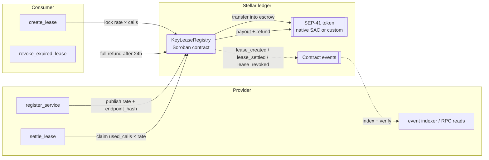

# keylease-core

> **A Soroban protocol on Stellar that turns metered API/RPC access into
> time-bound, escrowed micro-leases.**

[](https://github.com/KeyLease-Security/keylease-core/actions/workflows/ci.yml)
[](./LICENSE)
[](https://www.rust-lang.org)
[](https://crates.io/crates/soroban-sdk)
[](./docs/architecture.md)
[](https://keylease-security.github.io/keylease-core/)

`KeyLeaseRegistry` is a Rust/Soroban smart contract. A consumer locks a SEP-41
micropayment in escrow on the Stellar ledger and receives a **lease** — an
on-chain, expiring authorization for a fixed allotment of calls. The provider
reads that lease from Stellar, settles it once with a call count, and is paid
from escrow. Unused balance is refunded in the same transaction.

There is no static API key, no off-chain credential store, and no bespoke bearer
token. **The credential is the lease, and the lease lives on Stellar.**

> **Live on Testnet:** [`CCEZYHUJ…TAFH62`](https://stellar.expert/explorer/testnet/contract/CCEZYHUJUICXVPLH6UC2OFZL2RG23QQ7EMZOWE32WVQPT25DCTIAFH62)
> — v0.2.1 with demo service `1`. Creation, full settlement and a partial-refund
> settlement are verified on-chain; see [Deployments](./docs/deployments.md) for
> every transaction and the Wasm hash.

---

## Built on Soroban, not merely deployed to it

| Stellar / Soroban primitive | Where it is used | Why the protocol depends on it |
| --- | --- | --- |
| **SEP-41 tokens (SAC or custom)** | `contracts/registry/src/lib.rs` — `create_lease`, `settle_lease`, `revoke_expired_lease` | Every deposit, payout and refund is a cross-contract call to a token contract. The native Stellar Asset Contract escrows XLM; any SEP-41 asset works. |
| **`Address` authorization** | every state-changing entry point | Actors are Stellar accounts (`G…`) or contracts (`C…`) authenticated by the host's `require_auth()`. Multi-sig and smart-wallet accounts work with no contract change. |
| **Soroban contract events** | `contracts/registry/src/events.rs` | Each transition publishes a typed event with the ids in its topics, so indexers and providers can follow escrow from the RPC event stream instead of polling storage. |
| **Ledger time** | lease expiry and the 24-hour settlement grace window | Timestamps come from `env.ledger().timestamp()`, never from an off-chain clock. |
| **Persistent-storage TTL** | `contracts/registry/src/storage.rs` | Lease entries are extended for their whole term plus the grace window, so escrow can never be evicted while it is still claimable. |
| **`contractmeta!`** | `contracts/registry/src/lib.rs` | Name, version, description and repository are embedded in the Wasm and readable on-chain. |
| **Soroban deployer upgrades** | `upgrade(admin, new_wasm_hash)` | The admin can install a new Wasm through `update_current_contract_wasm`, keeping the contract id, balances and in-flight leases. |
| **`wasm32v1-none` + `soroban-sdk 26`** | `Cargo.toml`, CI | The workspace builds the exact artifact Stellar runs. |
| **Soroban test utilities incl. the real SAC** | `contracts/registry/src/test.rs` | The suite escrows against `register_stellar_asset_contract_v2`, not just a mock token. |

---

## Architecture



```text
keylease-core/
├── contracts/
│   ├── registry/          # the protocol: services, leases, escrow, settlement
│   │   ├── src/
│   │   │   ├── lib.rs     # entry points, contractmeta, upgrade, lifecycle docs
│   │   │   ├── events.rs  # typed Soroban events (the indexing surface)
│   │   │   ├── types.rs   # Service, Lease, LeaseStatus
│   │   │   ├── storage.rs # DataKey layout + duration-aware TTL policy
│   │   │   ├── errors.rs  # stable error codes
│   │   │   └── test.rs    # lifecycle, SAC, events, upgrade, re-entrancy tests
│   │   └── Cargo.toml
│   └── mock_token/        # minimal SEP-41 token for tests & local sandboxes
├── scripts/
│   ├── deploy-testnet.sh  # sequential testnet deploy / upgrade
│   ├── create-issues.sh   # batch Wave backlog creation from the templates
│   └── setup-repo.sh      # topics, labels, branch protection
├── docs/                  # Stellar-native protocol docs, guides and references
├── system-prompts/        # agent briefs for the contract and client repos
└── Cargo.toml             # workspace (Soroban SDK 26, wasm32v1-none)
```

---

## Contract interface

### `KeyLeaseRegistry`

| Entry point | Auth | Description |
| --- | --- | --- |
| `init(admin)` | `admin` | One-time initialization; appoints the protocol admin. Emits `registry_initialized`. |
| `set_token(admin, token)` | `admin` | Configure the SEP-41 escrow token (native SAC or custom). Emits `escrow_token_set`. |
| `upgrade(admin, new_wasm_hash)` | `admin` | Install a new Wasm through the Soroban deployer. Emits `contract_upgraded`. |
| `register_service(provider, rate_per_call, endpoint_hash) -> u64` | `provider` | Publish a leasable service. Returns `service_id`. Emits `service_registered`. |
| `set_service_active(provider, service_id, is_active)` | `provider` | Pause/resume new leases. Emits `service_status_changed`. |
| `create_lease(consumer, service_id, requested_calls, duration_secs) -> u64` | `consumer` | Lock `rate × calls` and mint a lease. Emits `lease_created`. |
| `settle_lease(provider, lease_id, verified_calls)` | `provider` | Pay the provider, refund the remainder. Emits `lease_settled`. |
| `revoke_expired_lease(consumer, lease_id)` | `consumer` | Reclaim the full deposit 24h after expiry. Emits `lease_revoked`. |
| `get_admin()`, `get_token()`, `get_service(id)`, `get_lease(id)`, `version()` | — | Read-only views. |
| `lease_status(id)`, `remaining_calls(id)`, `locked_balance(id)` | — | Derived lifecycle queries. |
| `service_count()`, `lease_count()` | — | Monotonic counters. |

### Events

Contract events are part of the protocol's public interface, not a debugging
extra. Event names are the first topic; ids follow.

| Event | Topics | Data |
| --- | --- | --- |
| `registry_initialized` | — | `admin` |
| `escrow_token_set` | — | `admin`, `token` |
| `service_registered` | `service_id` | `provider`, `rate_per_call`, `endpoint_hash` |
| `service_status_changed` | `service_id` | `provider`, `is_active` |
| `lease_created` | `lease_id` | `service_id`, `consumer`, `allocated_calls`, `expires_at`, `locked_deposit` |
| `lease_settled` | `lease_id` | `provider`, `verified_calls`, `payout`, `refund` |
| `lease_revoked` | `lease_id` | `consumer`, `refund` |
| `contract_upgraded` | — | `admin`, `new_wasm_hash` |

```bash
# Follow escrow from the ledger, no polling:
stellar events --id $REGISTRY --network testnet --start-ledger <ledger>
```

### Lifecycle

```
Active ──(expires_at reached)──▶ Expired ──(24h grace)──▶ revocable by consumer
   │                                  │
   └──(fully consumed)────────────────┴──(provider settles)──▶ Settled
```

A lease is **settleable** when it has expired **or** `verified_calls ==
allocated_calls`. It is **revocable** only when expired **and** the 24-hour
provider grace window has elapsed. Either path ends in `Settled`; a settled
lease can never be settled or revoked again.

---

## Quickstart

```bash
# 1. Toolchain (Rust 1.84+; wasm32v1-none is the Soroban target)
rustup target add wasm32v1-none

# 2. Build & test the workspace
cargo test --all

# 3. Lint the way CI does
cargo fmt --all -- --check
cargo clippy --all-targets -- -D warnings

# 4. Produce deployable Soroban WASM
cargo build --target wasm32v1-none --release --all
# → target/wasm32v1-none/release/keylease_registry.wasm
# → target/wasm32v1-none/release/keylease_mock_token.wasm
```

---

## Deploy to Stellar Testnet

One command runs the whole dependency-ordered sequence against the Stellar
network (build → deploy → `init` → `set_token` → `register_service`) and prints
the values a client or indexer needs:

```bash
SOURCE_ACCOUNT=keylease-admin ./scripts/deploy-testnet.sh

# or create and Friendbot-fund the identity first (testnet only):
KEYLEASE_GENERATE_KEY=1 SOURCE_ACCOUNT=keylease-admin ./scripts/deploy-testnet.sh
```

The raw sequence it automates:

```bash
stellar contract deploy \
  --wasm target/wasm32v1-none/release/keylease_registry.wasm \
  --source-account keylease-admin --network testnet --alias keylease-registry

stellar contract invoke --id $REGISTRY --network testnet --source-account keylease-admin \
  --send=yes -- init --admin $ADMIN

stellar contract invoke --id $REGISTRY --network testnet --source-account keylease-admin \
  --send=yes -- set_token --admin $ADMIN --token $TOKEN

stellar contract invoke --id $REGISTRY --network testnet --source-account keylease-admin \
  --send=yes -- register_service \
     --provider $PROVIDER --rate_per_call 1000000 --endpoint_hash <64_HEX_CHARS>
```

`--send=yes` is required for state-changing calls. Deployed addresses are
recorded in [`docs/deployments.md`](./docs/deployments.md) — never guessed.
Full options, upgrades and network settings are in
[`docs/deployment.md`](./docs/deployment.md) and
[`docs/networks.md`](./docs/networks.md). Runtime configuration is documented in
[`.env.example`](./.env.example).

---

## Documentation

📖 **Read the docs: <https://keylease-security.github.io/keylease-core/>**

Everything is built from [`docs/`](./docs/index.md) and describes the Soroban
protocol, its Stellar dependencies and how to integrate with it:

| Read | For |
| --- | --- |
| [Introduction](./docs/introduction.md) | what KeyLease is and why it is a Stellar protocol |
| [Architecture](./docs/architecture.md) | contract, storage, events and the token boundary |
| [How the protocol works](./docs/protocol.md) | state machine, events and worked economics |
| [Contract reference](./docs/contract-reference.md) | every entry point, event, parameter and error code |
| [Security model](./docs/security.md) | trust assumptions and known limitations |
| [Integration](./docs/integration.md) | verifying leases from Soroban RPC, Horizon and SEP-10 |
| [Networks](./docs/networks.md) | RPC endpoints, passphrases, SAC addresses and resets |
| [Provider](./docs/provider-guide.md) / [Consumer](./docs/consumer-guide.md) guides | using the protocol |
| [Developer guide](./docs/developer-guide.md) | building, testing, upgrading and extending |
| [Deployment](./docs/deployment.md) | `stellar contract` commands and upgrade procedure |

---

## Security model

KeyLease escrows funds, so the contract is written to a small, auditable set of
invariants:

1. **Checked arithmetic everywhere.** Deposit (`rate × calls`) and payout math
   use `checked_mul`/`checked_add`; overflow aborts the transaction instead of
   minting a cheap lease or a truncated refund.
2. **Checks-effects-interactions.** Every money path persists the settlement
   (`settled = true`) *before* calling the token, so a re-entrant SEP-41 token
   cannot be paid twice. `test_reentrant_token_cannot_settle_a_lease_twice`
   installs a hostile token that calls back into `settle_lease` and asserts the
   second attempt is rejected.
3. **Bounded provider claims.** A provider can never withdraw more than
   `allocated_calls × rate_per_call`, and only for leases it owns
   (`InvalidCalls`, `Unauthorized`).
4. **Guaranteed consumer exit.** A provider that never settles cannot strand
   funds: after expiry + 24h the consumer reclaims the full deposit.
5. **TTL-safe leases.** `create_lease` caps `duration_secs` at
   `MAX_LEASE_DURATION_SECS` (30 days) and extends the lease's persistent entry
   for its whole term plus the grace window, so escrow cannot be evicted while
   it is still claimable.
6. **Explicit authorization.** Every state-changing entry point calls
   `require_auth()` on the actor it claims to represent, and cross-checks that
   actor against stored ownership where relevant.
7. **Bounded admin.** The admin can configure the token and upgrade the Wasm. It
   cannot move escrowed funds.

### Trusting the escrow token

The registry uses the standard SEP-41 `transfer` interface, so it works with the
native Stellar Asset Contract or a custom token. The token is set by the admin
via `set_token`. Because the token boundary is a cross-contract call, the money
paths follow checks-effects-interactions and have an adversarial test against a
re-entrant token.

> `contracts/mock_token` is a **test/sandbox-only** token with an unlimited mint.
> It must never be deployed to a network holding real value. The test suite
> additionally exercises the real Stellar Asset Contract.

---

## Testing

```bash
cargo test --all
```

The 40 tests in `contracts/registry/src/test.rs` cover:

- service registration and ID monotonicity,
- the happy path (lock → full-usage settle before expiry),
- partial settlement after expiry with correct refund,
- expired, unsettled leases being fully reclaimed by the consumer,
- the 24-hour grace window (boundary, early-settle, and post-settle cases),
- unauthorized settle/revoke/upgrade attempts,
- rate-math, timestamp and duration overflow/rejection,
- every emitted event, including its topics and payload,
- the full lifecycle escrowed with the **native Stellar Asset Contract**,
- a **re-entrant token** attempting a second settlement,
- status transitions and derived views.

---

## Contributing

See [CONTRIBUTING.md](./CONTRIBUTING.md). 

## Security

See [SECURITY.md](./SECURITY.md). Report vulnerabilities privately, never as a
public issue.

## License

[MIT](./LICENSE) © 2026 KeyLease Security
