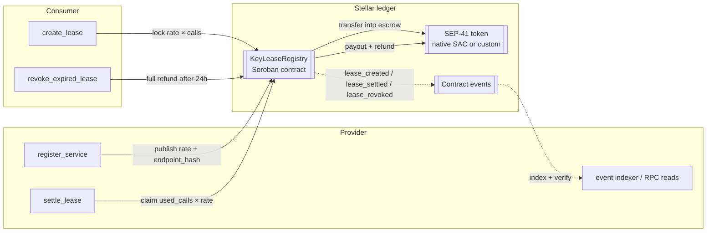

# keylease-core

> **A Soroban protocol on Stellar that turns metered API/RPC access into
> time-bound, escrowed micro-leases.**

[](https://github.com/KeyLease-Security/keylease-core/actions/workflows/ci.yml)
[](./LICENSE)
[](https://www.rust-lang.org)
[](https://crates.io/crates/soroban-sdk)
[](./docs/architecture.md)
[](https://keylease-security.github.io/keylease-core/)

`KeyLeaseRegistry` is a Rust/Soroban smart contract. A consumer locks a SEP-41
micropayment in escrow on the Stellar ledger and receives a **lease** — an
on-chain, expiring authorization for a fixed allotment of calls. The provider
reads that lease from Stellar, settles it once with a call count, and is paid
from escrow. Unused balance is refunded in the same transaction.

There is no static API key, no off-chain credential store, and no bespoke bearer
token. **The credential is the lease, and the lease lives on Stellar.**

> **Live on Testnet:** [`CCEZYHUJ…TAFH62`](https://stellar.expert/explorer/testnet/contract/CCEZYHUJUICXVPLH6UC2OFZL2RG23QQ7EMZOWE32WVQPT25DCTIAFH62)
> — v0.2.1 with demo service `1`. Creation, full settlement and a partial-refund
> settlement are verified on-chain; see [Deployments](./docs/deployments.md) for
> every transaction and the Wasm hash.

---

## Built on Soroban, not merely deployed to it

| Stellar / Soroban primitive | Where it is used | Why the protocol depends on it |
| --- | --- | --- |
| **SEP-41 tokens (SAC or custom)** | `contracts/registry/src/lib.rs` — `create_lease`, `settle_lease`, `revoke_expired_lease` | Every deposit, payout and refund is a cross-contract call to a token contract. The native Stellar Asset Contract escrows XLM; any SEP-41 asset works. |
| **`Address` authorization** | every state-changing entry point | Actors are Stellar accounts (`G…`) or contracts (`C…`) authenticated by the host's `require_auth()`. Multi-sig and smart-wallet accounts work with no contract change. |
| **Soroban contract events** | `contracts/registry/src/events.rs` | Each transition publishes a typed event with the ids in its topics, so indexers and providers can follow escrow from the RPC event stream instead of polling storage. |
| **Ledger time** | lease expiry and the 24-hour settlement grace window | Timestamps come from `env.ledger().timestamp()`, never from an off-chain clock. |
| **Persistent-storage TTL** | `contracts/registry/src/storage.rs` | Writes extend the lease entry for its whole term plus the grace window, so escrow cannot be evicted while it is still claimable. Reads never extend: `bump_lease` / `bump_service` do that, on purpose and on the caller's meter. |
| **`contractmeta!`** | `contracts/registry/src/lib.rs` | Name, version, description, repository and `eventSchemaVersion` are embedded in the Wasm and readable on-chain. |
| **Soroban deployer upgrades** | `upgrade(admin, new_wasm_hash)` | The admin can install a new Wasm through `update_current_contract_wasm`, keeping the contract id, balances and in-flight leases. |
| **`wasm32v1-none` + `soroban-sdk 26`** | `Cargo.toml`, CI | The workspace builds the exact artifact Stellar runs. |
| **Soroban test utilities incl. the real SAC** | `contracts/registry/src/test.rs` | The suite escrows against `register_stellar_asset_contract_v2`, not just a mock token. |

---

## Architecture



```text
keylease-core/
├── contracts/
│   ├── registry/          # the protocol: services, leases, escrow, settlement
│   │   ├── src/
│   │   │   ├── lib.rs     # entry points, contractmeta, upgrade, lifecycle docs
│   │   │   ├── events.rs  # typed Soroban events (the indexing surface)
│   │   │   ├── types.rs   # Service, Lease, ServiceStats, LeaseStatus
│   │   │   ├── storage.rs # DataKey layout + duration-aware TTL policy
│   │   │   ├── errors.rs  # stable error codes
│   │   │   └── test.rs    # lifecycle, SAC, events, upgrade, TTL, re-entrancy tests
│   │   └── Cargo.toml
│   └── mock_token/        # minimal SEP-41 token for tests & local sandboxes
├── scripts/
│   ├── deploy-testnet.sh  # sequential testnet deploy / upgrade
│   ├── check-no-std.sh    # CI guard: release Wasm has no std, crates forbid unsafe
│   ├── create-issues.sh   # batch Wave backlog creation (templates + 130-issue PSV)
│   └── setup-repo.sh      # topics, labels, branch protection
├── docs/                  # Stellar-native protocol docs, guides and references
├── system-prompts/        # agent briefs for the contract and client repos
└── Cargo.toml             # workspace (Soroban SDK 26, wasm32v1-none)
```

---

## Contract interface

### `KeyLeaseRegistry`

| Entry point | Auth | Description |
| --- | --- | --- |
| `init(admin)` | `admin` | One-time initialization; appoints the protocol admin. Emits `registry_initialized`. |
| `set_token(admin, token)` | `admin` | Configure the SEP-41 escrow token (native SAC or custom). Emits `escrow_token_set`. |
| `propose_upgrade(admin, new_wasm_hash)` | `admin` | Queue a Wasm behind the 24h delay. Emits `upgrade_proposed`. |
| `cancel_upgrade(admin)` | `admin` | Drop a pending proposal. Emits `upgrade_cancelled`. |
| `execute_upgrade(admin)` | `admin` | Install the proposed Wasm after the delay. Emits `contract_upgraded`. |
| `register_service(provider, rate_per_call, endpoint_hash) -> u64` | `provider` | Publish a leasable service. `rate_per_call` must be positive and at most `MAX_RATE_PER_CALL`. Returns `service_id`. Emits `service_registered`. |
| `set_service_active(provider, service_id, is_active)` | `provider` | Pause/resume new leases. Emits `service_status_changed`. |
| `update_service(provider, service_id, rate_per_call, endpoint_hash) -> service_id` | `provider` | Update rate and endpoint hash for a service. Emits `service_rate_updated`. Only the owning provider may call this. Existing leases keep their original rate. |
| `create_lease(consumer, service_id, requested_calls, duration_secs) -> u64` | `consumer` | Lock `rate × calls` and mint a lease. Emits `lease_created`. |
| `quote_lease(service_id, requested_calls, duration_secs) -> LeaseQuote` | — | Read-only deposit and expiry `create_lease` would produce, with the same validation. |
| `request_early_cancel(consumer, lease_id)` / `withdraw_early_cancel(consumer, lease_id)` | `consumer` | Ask to end an active lease early, or withdraw the request. |
| `approve_early_cancel(provider, lease_id, verified_calls)` / `reject_early_cancel(provider, lease_id)` | `provider` | Consent to an early exit (paying served calls and refunding the rest) or decline it. |
| `settle_lease(provider, lease_id, verified_calls)` | `provider` | Pay the provider, refund the remainder. Emits `lease_settled`. |
| `revoke_expired_lease(consumer, lease_id)` | `consumer` | Reclaim the full deposit 24h after expiry. Emits `lease_revoked`. |
| `bump_service(service_id)` | — | Extend a service entry's TTL to its standard horizon. Permissionless; the caller pays the rent. |
| `bump_lease(lease_id)` | — | Extend a live lease entry using the lease TTL policy. Permissionless; rejects a settled lease. |
| `get_admin()`, `get_token()`, `get_service(id)`, `get_lease(id)`, `version()` | — | Read-only views. Never extend a TTL. |
| `services_for_provider(provider, after, limit) -> ProviderServicePage` | — | One bounded page of a provider's service ids; page with `next` until `done`. Never extends a TTL. |
| `lease_status(id)`, `remaining_calls(id)`, `locked_balance(id)` | — | Derived lifecycle queries. Never extend a TTL. |
| `service_stats(service_id)` | — | Cumulative settled leases, calls and payout for one service. Never extend a TTL. |
| `service_count()`, `lease_count()` | — | Monotonic counters. |

### Events

Contract events are part of the protocol's public interface, not a debugging
extra. Event names are the first topic; ids follow.

Every payload also carries `schema_version`, the version of the event schema
that emitted it. It lives in the payload map, never in a topic, because topics
are positional and an indexer filters on them. See
[`docs/integration.md`](./docs/integration.md#event-schema-version) for how a
consumer of the stream should branch on it.

| Event | Topics | Data |
| --- | --- | --- |
| `registry_initialized` | — | `schema_version`, `admin` |
| `escrow_token_set` | — | `schema_version`, `admin`, `token` |
| `service_registered` | `service_id` | `schema_version`, `provider`, `rate_per_call`, `endpoint_hash` |
| `service_status_changed` | `service_id` | `schema_version`, `provider`, `is_active` |
| `lease_created` | `lease_id` | `schema_version`, `service_id`, `consumer`, `allocated_calls`, `expires_at`, `locked_deposit` |
| `lease_delegated` | `lease_id` | `schema_version`, `delegate`, `consumer` |
| `lease_cancellation_requested` | `lease_id` | `schema_version`, `consumer` |
| `lease_cancellation_rejected` | `lease_id` | `schema_version`, `provider` |
| `lease_cancellation_withdrawn` | `lease_id` | `schema_version`, `consumer` |
| `lease_cancelled` | `lease_id` | `schema_version`, `provider`, `consumer`, `verified_calls`, `payout`, `refund` |
| `lease_settled` | `lease_id` | `schema_version`, `provider`, `verified_calls`, `payout`, `refund` |
| `lease_revoked` | `lease_id` | `schema_version`, `consumer`, `refund` |
| `contract_upgraded` | — | `schema_version`, `admin`, `new_wasm_hash` |

`lease_created` is emitted unchanged whether the consumer or a delegate minted
the lease; `lease_delegated` is added on top and names who paid the transaction
fee. The delegate holds no claim on the lease.

```bash
# Follow escrow from the ledger, no polling:
stellar events --id $REGISTRY --network testnet --start-ledger <ledger>
```

### Lifecycle

```text
Active ──(fully consumed + provider settles)────────────────────▶ Settled
   │
   └──(expires_at reached)──▶ Expired ──(provider settles)──────▶ Settled
                                  │
                                  └──(24h grace + consumer revokes)──▶ Revoked
```

A lease is **settleable** when it has expired **or** `verified_calls ==
allocated_calls`. It is **revocable** only when expired **and** the 24-hour
provider grace window has elapsed. Provider settlement ends the lease as
`Settled`; consumer reclaim ends it as `Revoked`, and the two read differently
to clients: a revoked lease reports `used_calls == 0`, earns the provider
nothing, and never appears in `service_stats`. Either way a closed lease can
never be settled or revoked again. Before expiry the consumer can ask the
provider to end the lease early (`request_early_cancel`); if the provider
approves, served calls are paid and unused calls are refunded immediately,
ending the lease as `Settled` — and, because the provider earned those calls,
the settlement does count toward `service_stats`.

---

## Quickstart

```bash
# 1. Toolchain (Rust 1.84+; wasm32v1-none is the Soroban target)
rustup target add wasm32v1-none

# 2. Build & test the workspace
cargo test --all

# 3. Lint the way CI does
cargo fmt --all -- --check
cargo clippy --all-targets -- -D warnings
cargo clippy --target wasm32v1-none --release --all -- -D warnings

# 4. Produce deployable Soroban WASM
cargo build --target wasm32v1-none --release --all
# → target/wasm32v1-none/release/keylease_registry.wasm
# → target/wasm32v1-none/release/keylease_mock_token.wasm
```

---

## Deploy to Stellar Testnet

One command runs the whole dependency-ordered sequence against the Stellar
network (build → deploy → `init` → `set_token` → `register_service`) and prints
the values a client or indexer needs:

```bash
SOURCE_ACCOUNT=keylease-admin ./scripts/deploy-testnet.sh

# or create and Friendbot-fund the identity first (testnet only):
KEYLEASE_GENERATE_KEY=1 SOURCE_ACCOUNT=keylease-admin ./scripts/deploy-testnet.sh
```

The raw sequence it automates:

```bash
stellar contract deploy \
  --wasm target/wasm32v1-none/release/keylease_registry.wasm \
  --source-account keylease-admin --network testnet --alias keylease-registry

stellar contract invoke --id $REGISTRY --network testnet --source-account keylease-admin \
  --send=yes -- init --admin $ADMIN

stellar contract invoke --id $REGISTRY --network testnet --source-account keylease-admin \
  --send=yes -- set_token --admin $ADMIN --token $TOKEN

stellar contract invoke --id $REGISTRY --network testnet --source-account keylease-admin \
  --send=yes -- register_service \
     --provider $PROVIDER --rate_per_call 1000000 --endpoint_hash <64_HEX_CHARS>
```

Upgrade an existing deployment in place (build → upload → `upgrade` → check
`version()` against the workspace version):

```bash
./scripts/upgrade.sh --contract-id C... --admin keylease-admin
```

`--send=yes` is required for state-changing calls. Deployed addresses are
recorded in [`docs/deployments.md`](./docs/deployments.md) — never guessed.
Full options, upgrades and network settings are in
[`docs/deployment.md`](./docs/deployment.md) and
[`docs/networks.md`](./docs/networks.md). Runtime configuration is documented in
[`.env.example`](./.env.example).

---

## Documentation

📖 **Read the docs: <https://keylease-security.github.io/keylease-core/>**

Everything is built from [`docs/`](./docs/index.md) and describes the Soroban
protocol, its Stellar dependencies and how to integrate with it:

| Read | For |
| --- | --- |
| [Introduction](./docs/introduction.md) | what KeyLease is and why it is a Stellar protocol |
| [Architecture](./docs/architecture.md) | contract, storage, events and the token boundary |
| [How the protocol works](./docs/protocol.md) | state machine, events and worked economics |
| [Contract reference](./docs/contract-reference.md) | every entry point, event, parameter and error code |
| [Security model](./docs/security.md) | trust assumptions and known limitations |
| [Integration](./docs/integration.md) | verifying leases from Soroban RPC, Horizon and SEP-10 |
| [Networks](./docs/networks.md) | RPC endpoints, passphrases, SAC addresses and resets |
| [Provider](./docs/provider-guide.md) / [Consumer](./docs/consumer-guide.md) guides | using the protocol |
| [Developer guide](./docs/developer-guide.md) | building, testing, upgrading and extending |
| [Deployment](./docs/deployment.md) | `stellar contract` commands and upgrade procedure |
| [Troubleshooting](./docs/troubleshooting.md) | every failure by actor, with the command that verifies it |

---

## Security model

KeyLease escrows funds, so the contract is written to a small, auditable set of
invariants:

1. **Checked arithmetic everywhere.** Deposit (`rate × calls`) and payout math
   use `checked_mul`/`checked_add`; overflow aborts the transaction instead of
   minting a cheap lease or a truncated refund.
2. **Checks-effects-interactions.** Every money path persists the settlement
   (`settled = true`) *before* calling the token, so a re-entrant SEP-41 token
   cannot be paid twice. `test_reentrant_token_cannot_settle_a_lease_twice`
   installs a hostile token that calls back into `settle_lease` and asserts the
   second attempt is rejected.
3. **Bounded provider claims.** A provider can never withdraw more than
   `allocated_calls × rate_per_call`, and only for leases it owns
   (`InvalidCalls`, `Unauthorized`).
4. **Guaranteed consumer exit.** A provider that never settles cannot strand
   funds: after expiry + 24h the consumer reclaims the full deposit.
5. **TTL-safe leases.** `create_lease` caps `duration_secs` at
   `MAX_LEASE_DURATION_SECS` (30 days) and extends the lease's persistent entry
   for its whole term plus the grace window, so escrow cannot be evicted while
   it is still claimable. Every extension is clamped to
   `MAX_ENTRY_TTL_LEDGERS` (90 days) and to the network's live `maxEntryTtl`, so
   no entry horizon is derived only from a stored `expires_at`.
6. **Bounded deposits.** `create_lease` rejects a `rate_per_call ×
   requested_calls` product above `MAX_LEASE_DEPOSIT` with `DepositTooLarge`,
   before allocating a lease id or calling the token. Checked arithmetic cannot
   cover this: a product can fit `i128` and still be far more than the consumer
   meant to lock.
7. **Listed prices are leasable.** `register_service` caps `rate_per_call` at
   `MAX_RATE_PER_CALL`, which equals `MAX_LEASE_DEPOSIT` — so no service can be
   advertised at a price that cannot fund even a one-call lease, and every
   accepted deposit and payout stays inside `i128`.
8. **Explicit authorization.** Every state-changing entry point calls
   `require_auth()` on the actor it claims to represent, and cross-checks that
   actor against stored ownership where relevant. A delegate sponsoring
   `create_lease_for` needs the consumer's signature as well, so no third party
   can lock a balance it does not own.
9. **Revocation is not settlement.** A reclaimed lease reports
   `LeaseStatus::Revoked`, keeps `used_calls == 0`, and never enters
   `service_stats`, so refund and revenue stay distinguishable to any reader.
10. **Bounded admin.** The admin can configure the token and upgrade the Wasm. It
   cannot move escrowed funds.

### Trusting the escrow token

The registry uses the standard SEP-41 `transfer` interface, so it works with the
native Stellar Asset Contract or a custom token. The token is set by the admin
via `set_token`. Because the token boundary is a cross-contract call, the money
paths follow checks-effects-interactions and have an adversarial test against a
re-entrant token.

> `contracts/mock_token` is a **test/sandbox-only** token with an unlimited mint.
> It must never be deployed to a network holding real value. The test suite
> additionally exercises the real Stellar Asset Contract.

### Audit status

**This contract has not been independently audited.** As of v0.2.1 no third party
has reviewed `contracts/registry`, no firm is engaged, and no report exists. The
numbered properties in the model above are what the authors believe and test, not
what an outside reviewer has confirmed.

What stands in place of an audit:

| Coverage | Amount |
| --- | --- |
| Contract tests, including two adversarial ones | 63 in `contracts/registry/src/test.rs` |
| Security properties this README states | 8, in [Security model](#security-model) |
| Invariants asserted outright in tests | 5, in [Security model → Invariants](./docs/security.md#invariants) |
| Threats modelled | 14, in [Security model → Threats considered](./docs/security.md#threats-considered) |
| CI gates on every PR | 8 (`Format`, `Clippy`, `Test`, `Build (wasm32v1-none)`, `Spell Check`, `Markdown Lint`, `Dependency Policy`, `Malware Scan`) |

The eight above are the security properties this README claims; the five are the
ones `contracts/registry/src/test.rs` asserts outright. They overlap and are not
the same list, which is itself a fact an auditor would want.

The adversarial pair is `test_reentrant_token_cannot_settle_a_lease_twice`, which
installs a token that calls back into `settle_lease` mid-payout, and the full
lifecycle test escrowed with the **native Stellar Asset Contract** instead of the
mock. Neither is a substitute for a reviewer asking what the suite never thought
to assert.

Mainnet is therefore **not deployed and not scheduled**: it is deferred until an
independent audit is published, its findings fixed with tests, and the admin's
upgrade power bounded by a multisig or timelock. The full gate list is in
[Security model → Audit status](./docs/security.md#audit-status), and
[SECURITY.md](./SECURITY.md) carries the same statement for reporters. Use this
on Testnet, where the escrow is fake XLM and the worst failure costs an
afternoon of redeploying.

---

## Testing

```bash
cargo test --all
```

The 133 tests in `contracts/registry/src/test.rs` cover:

- service registration and ID monotonicity,
- the happy path (lock → full-usage settle before expiry),
- early cancellation with provider consent, refusal, withdrawal, authorization,
  conservation at both extremes, and rejection after settlement,
- partial settlement after expiry with correct refund,
- expired, unsettled leases being fully reclaimed by the consumer,
- the 24-hour grace window (boundary, early-settle, and post-settle cases),
- unauthorized settle/revoke/upgrade attempts,
- rate-math, timestamp and duration overflow/rejection,
- the deposit ceiling at the limit, one unit above it, and as a product,
- the published-price bound, and the one-call lease it still has to fund,
- per-service settlement totals, including zero-call settlements,
- delegated creation: both signatures required, refund owned by the consumer,
- revoked leases excluded from `service_stats` and read as `Revoked`,
- every emitted event, including its topics and payload,
- the `schema_version` on each payload, and that topics stay position-stable,
- reads that never extend a TTL, including the revocation marker and the
  settlement counters,
- the explicit `bump_service` / `bump_lease` maintenance calls and the lease TTL
  policy behind them,
- the full lifecycle escrowed with the **native Stellar Asset Contract**,
- a **re-entrant token** attempting a second settlement,
- status transitions and derived views,
- the stored `LeaseStatus` and `Error` discriminants, so nothing existing can be
  silently renumbered.

---

## Contributing

See [CONTRIBUTING.md](./CONTRIBUTING.md).

## Security

See [SECURITY.md](./SECURITY.md). Report vulnerabilities privately, never as a
public issue.

## License

[MIT](./LICENSE) © 2026 KeyLease Security
