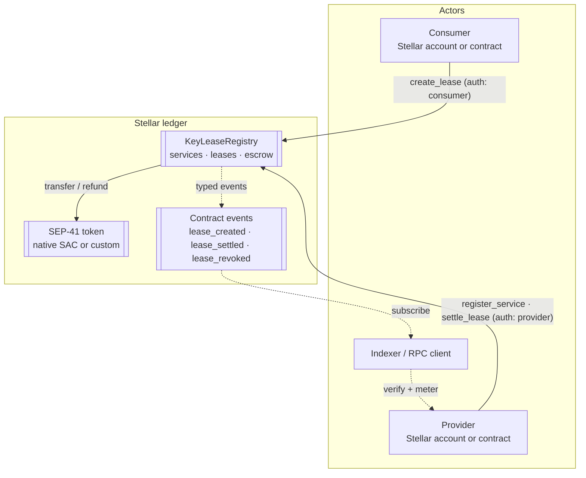
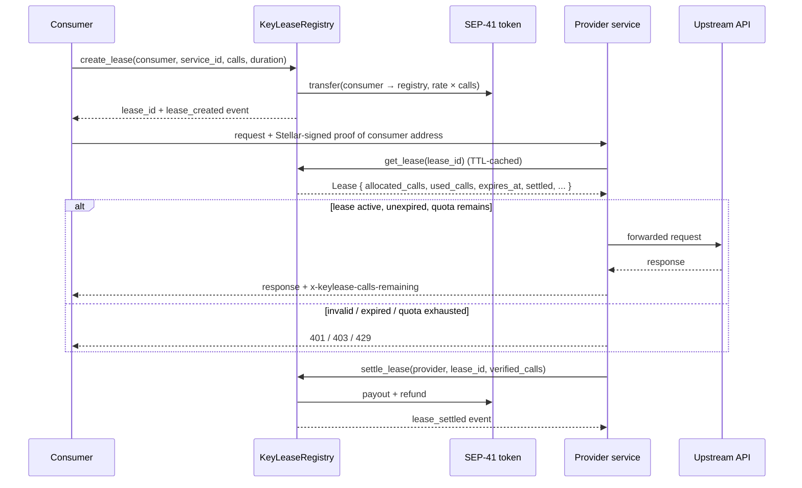

# Architecture

KeyLease is one Soroban contract and the Stellar ledger it runs on. There is no
second source of truth: services, leases, escrow balances and lifecycle history
all live on-chain, and the contract exposes them through entry points and
contract events.

## Components



### `KeyLeaseRegistry`

A pure Rust Soroban contract. It is the only component that can move value.

| Module | Role |
| --- | --- |
| `lib.rs` | Entry points, `contractmeta!`, upgrade, lifecycle documentation. |
| `types.rs` | `Service`, `Lease`, `LeaseStatus`. |
| `storage.rs` | `DataKey` layout, instance/persistent split, duration-aware TTL policy. |
| `events.rs` | Typed `#[contractevent]` payloads for every transition. |
| `errors.rs` | Stable error codes (part of the ABI). |

The registry is deliberately small. It does not know what an HTTP request is,
what the endpoint does, or who is calling it. It knows `service_id`,
`allocated_calls`, `expires_at` and `locked_deposit`.

### SEP-41 token

The registry holds no privileged token logic. It calls the standard SEP-41
`transfer` on the token configured by the admin:

- the **native Stellar Asset Contract** wraps XLM (the usual Testnet choice),
- any custom SEP-41 asset works without a contract change,
- `contracts/mock_token` exists only for tests and local sandboxes.

The token boundary is a cross-contract call, so the money paths follow
checks-effects-interactions and are tested against a re-entrant token.

### Consumers of the ledger

There is no privileged off-chain service. Anyone can observe the protocol using
standard Stellar tooling:

| Consumer | How it reads the protocol |
| --- | --- |
| Provider request path | `get_lease` over Soroban RPC (cached for a short TTL), or a local projection built from the event stream. |
| Accounting / dashboards | `stellar events`, Horizon or an indexer subscribing to `lease_created` / `lease_settled` / `lease_revoked`. |
| CLI tooling | `stellar contract invoke` for writes and reads (reads need any funded `--source-account`). |

See [Integration](integration.md) for the concrete verification pipeline.

## Data flow: one metered call



## Why the contract is minimal

**Every line of on-chain code is attack surface for escrowed funds.**
`endpoint_hash` is a commitment precisely so the contract never has to reason
about off-chain credentials. Usage reporting is a single settlement call rather
than one transaction per API call, which keeps the protocol affordable for small
allotments.

**Off-chain enforcement is replaceable.** A provider can read leases directly
over RPC, run an indexer, or write their own middleware. The protocol does not
depend on any of those being alive: if a proxy is down, providers can still
settle with `stellar contract invoke`, and consumers can still revoke.

**Trust flows one way.** Off-chain code trusts the ledger for lease state. The
contract trusts nobody: every mutating entry point authenticates the actor it
claims to represent, and the consumer always has an exit.

## Storage

| Key | Storage | TTL policy |
| --- | --- | --- |
| `Admin`, `Token` | instance | extended on every state change (≈30 days) |
| `ServiceCount`, `LeaseCount` | instance | same as instance |
| `Service(u64)` | persistent | extended on save and on read (≈30 days) |
| `Lease(u64)` | persistent | extended for the lease's remaining term **plus** the 24h grace window and a one-day read buffer |

`create_lease` caps `duration_secs` at `MAX_LEASE_DURATION_SECS` (30 days), so
the TTL extension is bounded and a locked deposit can never outlive its entry.
Only the time a lease can be acted on is paid for, so Soroban rent does not
dominate short leases. The host still clamps TTL to its minimum persistent TTL
(≈7 days on Testnet).

## Repository layout

```text
keylease-core/
├── contracts/
│   ├── registry/          # the protocol
│   │   ├── src/lib.rs     # entry points, contractmeta, upgrade
│   │   ├── src/events.rs  # typed Soroban events
│   │   ├── src/types.rs   # Service, Lease, LeaseStatus
│   │   ├── src/storage.rs # DataKey layout + TTL policy
│   │   ├── src/errors.rs  # stable error codes
│   │   └── src/test.rs    # lifecycle, SAC, events, upgrade, re-entrancy
│   └── mock_token/        # test-only SEP-41 token
├── scripts/               # deploy/upgrade, issue generation, repo setup
├── docs/                  # this documentation
└── Cargo.toml             # workspace (soroban-sdk 26)
```

## Read next

- [How the protocol works](protocol.md) — the state machine, events and worked economics.
- [Contract reference](contract-reference.md) — the ABI in full.
