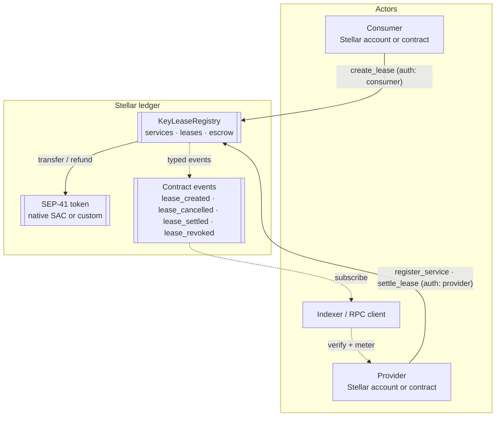
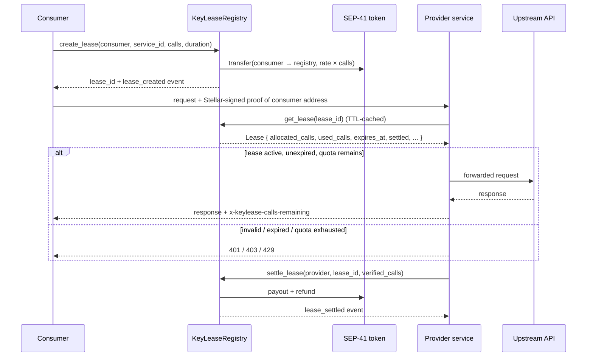
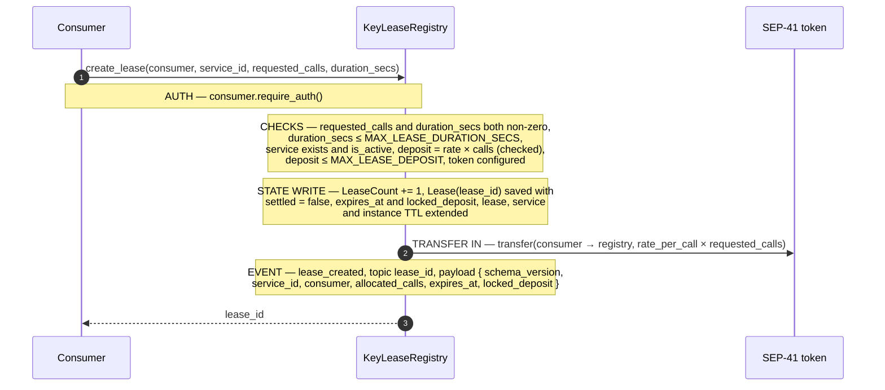
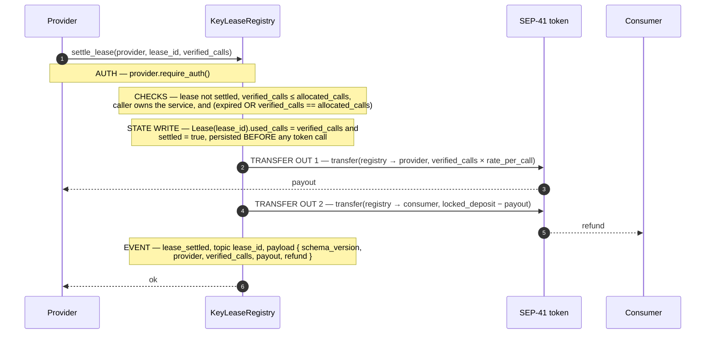
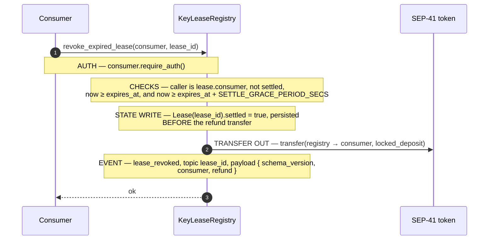

# Architecture

KeyLease is one Soroban contract and the Stellar ledger it runs on. There is no
second source of truth: services, leases, escrow balances and lifecycle history
all live on-chain, and the contract exposes them through entry points and
contract events.

## Components



### `KeyLeaseRegistry`

A pure Rust Soroban contract. It is the only component that can move value.

| Module | Role |
| --- | --- |
| `lib.rs` | Entry points, `contractmeta!`, upgrade, lifecycle documentation. |
| `types.rs` | `Service`, `Lease`, `ServiceStats`, `LeaseStatus`. |
| `storage.rs` | `DataKey` layout, instance/persistent split, duration-aware TTL policy. |
| `events.rs` | Typed `#[contractevent]` payloads for every transition. |
| `errors.rs` | Stable error codes (part of the ABI). |

The registry is deliberately small. It does not know what an HTTP request is,
what the endpoint does, or who is calling it. It knows `service_id`,
`allocated_calls`, `expires_at` and `locked_deposit`.

### SEP-41 token

The registry holds no privileged token logic. It calls the standard SEP-41
`transfer` on the token configured by the admin:

- the **native Stellar Asset Contract** wraps XLM (the usual Testnet choice),
- any custom SEP-41 asset works without a contract change,
- `contracts/mock_token` exists only for tests and local sandboxes.

The token boundary is a cross-contract call, so the money paths follow
checks-effects-interactions and are tested against a re-entrant token.

### Consumers of the ledger

There is no privileged off-chain service. Anyone can observe the protocol using
standard Stellar tooling:

| Consumer | How it reads the protocol |
| --- | --- |
| Provider request path | `get_lease` over Soroban RPC (cached for a short TTL), or a local projection built from the event stream. |
| Accounting / dashboards | `stellar events`, Horizon or an indexer subscribing to `lease_created` / `lease_cancelled` / `lease_settled` / `lease_revoked`. |
| CLI tooling | `stellar contract invoke` for writes and reads (reads need any funded `--source-account`). |

See [Integration](integration.md) for the concrete verification pipeline.

## Data flow: one metered call



Settlement is drawn as one arrow there because the request path is the subject.
The two transfer legs are itemised below.

## The money paths in order

The component diagram says who may talk to whom; it does not say in what order
value moves. The order is the security property. There are exactly three paths
that move tokens, only one of them moves twice, and in every one of them the
lease is written to storage **before** the token is called — so a token that
tries to re-enter the registry during the transfer sees the final state, not the
state before the money moved.

Each step below is labelled with the authorization that opened it and the state
it wrote, because a reader auditing escrow needs both, not just the arrows.

### 1. `create_lease` — one transfer, into escrow



Nothing can be claimed before the `STATE WRITE` step exists: the escrow transfer
and the lease record are the same transaction, so either both are visible
on-chain or neither is. A consumer that cannot fund the deposit never gets a
lease id.

### 2. `settle_lease` — two transfers, out of escrow



`payout + refund == locked_deposit` always, and a leg of zero is skipped rather
than emitted as a transfer. The `STATE WRITE` above the two arrows is what makes
the pair atomic against a malicious token: after a re-entrant call the lease
already reads `settled`, so the second settlement attempt fails with
`LeaseAlreadySettled` (7) instead of paying twice.
`test_reentrant_token_cannot_settle_a_lease_twice` holds that line.

### 3. `revoke_expired_lease` — one transfer, after the grace window



The provider is deliberately absent from this diagram: it has no role in a
revocation and no way to veto one. It can only pre-empt it, by settling first —
which is exactly what the 24-hour grace window before this point is for. Nothing
in the contract closes the settlement door when the window ends, so a lease in
`Expired` is still a race, and the consumer wins it by acting after the deadline.

The refund is the **full** `locked_deposit`, not the unused remainder: the
provider that never settled earned nothing. `used_calls` stays at `0` on this
path, which keeps the accounting unambiguous — a revoked lease is a lease that
was never paid for.

| Path | Who authenticates | State written first | Token transfers out |
| --- | --- | --- | --- |
| `create_lease` | consumer | `Lease(lease_id)`, `LeaseCount` | — (one transfer **in**) |
| `settle_lease` | provider (must own the service) | `used_calls`, `settled = true` | payout + refund |
| `revoke_expired_lease` | consumer (must be the lease's) | `settled = true` | full `locked_deposit` |

Read the deadlines and the worked numbers in
[How the protocol works](protocol.md#the-24-hour-grace-window).

## Why the contract is minimal

**Every line of on-chain code is attack surface for escrowed funds.**
`endpoint_hash` is a commitment precisely so the contract never has to reason
about off-chain credentials. Usage reporting is a single settlement call rather
than one transaction per API call, which keeps the protocol affordable for small
allotments.

**Off-chain enforcement is replaceable.** A provider can read leases directly
over RPC, run an indexer, or write their own middleware. The protocol does not
depend on any of those being alive: if a proxy is down, providers can still
settle with `stellar contract invoke`, and consumers can still revoke.

**Trust flows one way.** Off-chain code trusts the ledger for lease state. The
contract trusts nobody: every mutating entry point authenticates the actor it
claims to represent, and the consumer always has an exit.

## Storage

| Key | Storage | TTL policy |
| --- | --- | --- |
| `Admin`, `Token` | instance | extended on every state change (≈30 days) |
| `ServiceCount`, `LeaseCount` | instance | same as instance |
| `Service(u64)` | persistent | extended on save and by `bump_service` (≈30 days) |
| `Lease(u64)` | persistent | extended for the lease's remaining term **plus** the 24h grace window and a one-day read buffer, or by `bump_lease` |
| `ServiceStats(u64)` | persistent | extended on settlement only (≈30 days); derived data, so aging out loses a convenience counter, not money |
| `LeaseRevoked(u64)` | persistent | written when a consumer reclaims, given the same horizon as its lease in that transaction, so a readable lease always has a readable marker |
| `CancelRequest(u64)` | persistent | pending early-cancellation request; standard ~30-day TTL, removed on withdraw/reject/approve |

### What extends a TTL, and what does not

An extension moves the entry's `liveUntilLedgerSeq`, which the host books as a
rent bump and bills the caller for across the whole extended horizon. Only these
calls extend anything:
`init`, `set_token`, `upgrade`, `register_service`, `set_service_active`,
`create_lease`, `settle_lease`, `revoke_expired_lease`, `bump_service` and
`bump_lease` — and, since PR #152, `set_token` only when it actually changes the
configured token. Every read-only view — `get_service`, `get_lease`,
`lease_status`, `remaining_calls`, `locked_balance`, `service_stats` — is pure,
so a simulation of a view costs instructions and no rent. In particular
`lease_status` consulting the revocation marker and `service_stats` reading the
settlement counters both extend nothing: each of those entries is sized by the
write that created it, and a marker is never left alive longer than the lease it
describes. At the ledger where an extension is due, `get_lease` estimates at 113
stroops (all instructions) against 48,798 for `bump_lease`, of which 48,684 is
persistent rent.

Because reads stopped bumping, state that is only ever looked at has to be kept
alive deliberately, and `create_lease` therefore extends the service it leases
from: an actively leased service never goes stale under its own leases.

`create_lease` caps `duration_secs` at `MAX_LEASE_DURATION_SECS` (30 days), so
the TTL extension is bounded and a locked deposit can never outlive its entry.
Only the time a lease can be acted on is paid for, so Soroban rent does not
dominate short leases.

Three bounds sit on top of each other, and each one is deliberately below the
next:

| Bound | Ledgers | Set by |
| --- | --- | --- |
| longest lease's policy ask (30-day term + 24h grace + 1-day buffer) | 552,960 | `MAX_LEASE_DURATION_SECS` |
| contract ceiling for any single extension | 1,555,200 (90 days) | `MAX_ENTRY_TTL_LEDGERS` |
| network `maxEntryTtl` | 6,312,000 | Stellar protocol |

The ceiling is above every horizon a valid lease can produce, so it never
truncates one; what it bounds is an entry whose `expires_at` was not produced by
today's `create_lease` — one migrated in by an upgrade, or one created after the
duration cap is raised. Each extension also takes the minimum of that ceiling and
`env.storage().max_ttl()`, so a network that lowers `maxEntryTtl` is followed
rather than contradicted.

## Repository layout

```text
keylease-core/
├── contracts/
│   ├── registry/          # the protocol
│   │   ├── src/lib.rs     # entry points, contractmeta, upgrade
│   │   ├── src/events.rs  # typed Soroban events
│   │   ├── src/types.rs   # Service, Lease, LeaseStatus
│   │   ├── src/storage.rs # DataKey layout + TTL policy
│   │   ├── src/errors.rs  # stable error codes
│   │   └── src/test.rs    # lifecycle, SAC, events, upgrade, re-entrancy
│   └── mock_token/        # test-only SEP-41 token
├── scripts/               # deploy/upgrade, issue generation, repo setup
├── docs/                  # this documentation
└── Cargo.toml             # workspace (soroban-sdk 26)
```

## Read next

- [How the protocol works](protocol.md) — the state machine, events and worked economics.
- [Contract reference](contract-reference.md) — the ABI in full.
