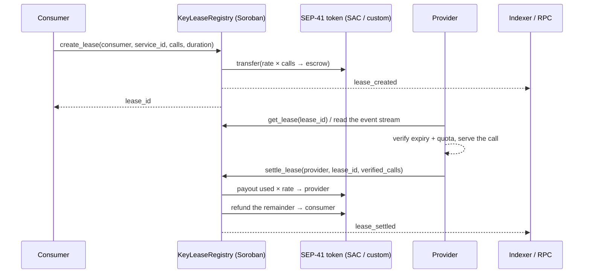

# KeyLease

> **A Soroban protocol on Stellar that turns metered API/RPC access into
> time-bound, escrowed micro-leases.**

KeyLease replaces long-lived static API keys with **leases**: expiring on-chain
authorizations backed by a SEP-41 micropayment held in Soroban escrow. Providers
publish a price instead of a secret; consumers pay only for the calls they use;
the Stellar ledger holds the truth about every lease.

- **Repository:** [keylease-core](https://github.com/KeyLease-Security/keylease-core) — the Soroban contracts
- **License:** MIT

## Start here

| I want to… | Read |
| --- | --- |
| understand what KeyLease is and why it is on Stellar | [Introduction](introduction.md) |
| see how the contract, storage and events fit together | [Architecture](architecture.md) |
| understand the state machine, events and the economics | [How the protocol works](protocol.md) |
| look up an entry point, event or error code | [Contract reference](contract-reference.md) |
| verify leases from my own service | [Integration](integration.md) |
| find RPC endpoints, passphrases and SAC addresses | [Networks](networks.md) |
| sell access to my API | [Provider guide](provider-guide.md) |
| buy metered access to an API | [Consumer guide](consumer-guide.md) |
| build on, test or upgrade the contract | [Developer guide](developer-guide.md) |
| deploy with the Stellar CLI | [Deployment](deployment.md) |
| understand the trust assumptions | [Security model](security.md) |

## The Stellar loop

## Status

⚠️ **Pre-1.0 and not independently audited.** Suitable for Stellar Testnet and
limited-value evaluation. See [Deployments](deployments.md) for the contract-id
registry and [Security](security.md) for the current limitations.
