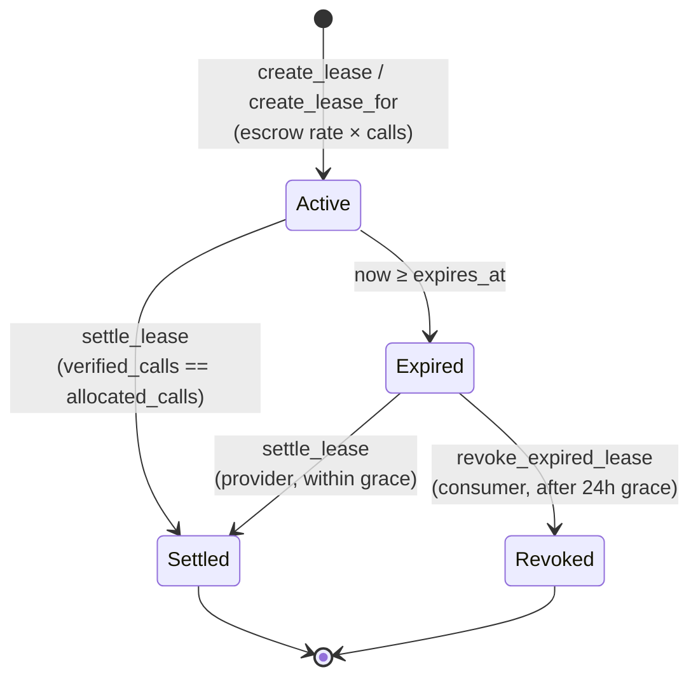

# How the protocol works

## Actors

| Actor | Address | Can do |
| --- | --- | --- |
| **Admin** | one Stellar account | `init` once, `set_token`, `upgrade`. Cannot move escrowed funds. |
| **Provider** | per service (account or contract address) | Register/pause services, settle leases it owns. |
| **Consumer** | per lease (account or contract address) | Create leases, revoke expired unsettled leases. |
| **Delegate** | optional, any account | Sponsor `create_lease_for` for a consumer. Pays the transaction fee only — never the deposit, and holds no claim on the lease. |

The admin is a deployment role. It can point the registry at a token address and
install a new Wasm, and nothing else. It has no path to user funds.

Because every actor is a Soroban `Address`, the same protocol works for classic
Stellar accounts (`G…`), multisig accounts and smart contracts (`C…`).

## State

### Service

```rust
pub struct Service {
    pub service_id: u64,
    pub provider: Address,
    pub rate_per_call: i128,   // smallest unit of the escrow token
    pub is_active: bool,
    pub endpoint_hash: BytesN<32>,
}
```

A service is *not* an endpoint URL and *not* a credential. It is a price and a
commitment. `endpoint_hash` is a 32-byte digest of the provider's off-chain
descriptor, so the on-chain record proves what the endpoint *should* be without
publishing anything secret.

### Lease

```rust
pub struct Lease {
    pub lease_id: u64,
    pub service_id: u64,
    pub consumer: Address,
    pub allocated_calls: u32,
    pub used_calls: u32,
    pub expires_at: u64,       // unix seconds, ledger time
    pub locked_deposit: i128,  // rate_per_call * allocated_calls
    pub settled: bool,
}
```

## Lifecycle



`lease_status` derives the state from `settled`, `expires_at` and the lease's
revocation marker:

| Status | Discriminant | Condition |
| --- | --- | --- |
| `Active` | `0` | not settled, `now < expires_at` |
| `Expired` | `1` | not settled, `now ≥ expires_at` |
| `Settled` | `2` | `settled == true`, provider was paid |
| `Revoked` | `3` | `settled == true`, consumer reclaimed the deposit |

Discriminants are **stable on the wire**. They will never be renumbered, and
`Revoked` was appended as `3` rather than replacing `Settled`, so a client
written before the change still decodes every pre-existing lease. The two
closed states share the same stored `settled` flag — `Lease` layout is frozen —
and are told apart by the `LeaseRevoked(lease_id)` marker the registry writes
when a consumer reclaims.

### Two ways to close a lease, one stored flag

`settled` records that escrow has left the contract — it does not record *why*.
Both terminal transitions set it: `settle_lease` after paying the provider, and
`revoke_expired_lease` after refunding the consumer in full.
`Error::LeaseAlreadySettled` (7) keeps that combined meaning: either way the
escrow is gone, so neither path may run twice.

Why it *left* is recorded separately, in the `LeaseRevoked(lease_id)` marker
that `revoke_expired_lease` writes before the refund. It is a second key rather
than a `Lease` field because the stored struct is part of the decoding ABI: a
new field would stop live leases from decoding. `lease_status` reads the flag,
the marker and the clock, and so answers "did the provider earn?" directly:

| Lifecycle event | `settled` | `used_calls` | `lease_status` |
| --- | --- | --- | --- |
| `create_lease` | `false` | `0` | `Active` |
| `settle_lease(320)` of 500, after expiry | `true` | `320` | `Settled` |
| `settle_lease(0)` of 500, after expiry | `true` | `0` | `Settled` |
| `revoke_expired_lease` after the grace window | `true` | `0` | `Revoked` |

One row still needs the event to be read fully: `settle_lease(0)` — the
provider's legitimate way of refunding a lease it could not serve — is
`Settled` with `used_calls == 0`, so the status says "no revenue" without
naming it as a refund. `lease_settled` carries `payout = 0` and `refund` for
that lease, and it is the record an accountant should trust anyway.

The full state-by-event table, including `remaining_calls` and
`locked_balance`, is in
[`LeaseStatus` and the `settled` flag](contract-reference.md#leasestatus-and-the-settled-flag),
and how to consume the two events is in
[Following the event stream](integration.md#following-the-event-stream).

### When can a lease be settled?

`settle_lease` reverts with `LeaseNotSettleable` unless **either**:

- the lease has expired (`now ≥ expires_at`), **or**
- `verified_calls == allocated_calls`.

The second clause is the "consumer got what it paid for" fast path: if every
allocated call was consumed, the provider should not have to wait for expiry to
be paid.

### The 24-hour grace window

After expiry there is a 24-hour window (`SETTLE_GRACE_PERIOD_SECS = 86_400`)
during which **only the provider** can settle. Once it elapses, the consumer may
call `revoke_expired_lease` and reclaim the entire deposit.

```text
expires_at ────────────────────┬─────────────────────────────┬──────────────▶ time
                               │                             │
                        expiry reached              expires_at + 24h
                               │                             │
        provider may settle for the whole window    consumer may revoke
                               │                             │
                        ───────┴──── provider grace ─────────┘
```

Why a grace window at all? Without it, a provider that was offline for a minute
at expiry would lose a legitimate payout to a consumer racing to revoke. The
window gives providers a guaranteed settlement period while keeping the
consumer's exit bounded at 24 hours.

## Events

Every transition publishes a typed Soroban event. Event names are the first
topic, followed by the id fields marked `#[topic]`; the payload is a map of the
remaining fields. Each payload also carries `schema_version`, so a stream that
spans a contract upgrade stays decodable (see
[Integration → Event schema version](integration.md#event-schema-version)).

| Event | Topics | Data |
| --- | --- | --- |
| `registry_initialized` | — | `schema_version`, `admin` |
| `escrow_token_set` | — | `schema_version`, `admin`, `token` |
| `service_registered` | `service_id` | `schema_version`, `provider`, `rate_per_call`, `endpoint_hash` |
| `service_status_changed` | `service_id` | `schema_version`, `provider`, `is_active` |
| `lease_created` | `lease_id` | `schema_version`, `service_id`, `consumer`, `allocated_calls`, `expires_at`, `locked_deposit` |
| `lease_delegated` | `lease_id` | `schema_version`, `delegate`, `consumer` |
| `lease_settled` | `lease_id` | `schema_version`, `provider`, `verified_calls`, `payout`, `refund` |
| `lease_revoked` | `lease_id` | `schema_version`, `consumer`, `refund` |
| `contract_upgraded` | — | `schema_version`, `admin`, `new_wasm_hash` |

`lease_delegated` follows `lease_created` only for a sponsored lease, so
indexers that ignore it still see every lease.

Events are the indexing contract between on-chain state and off-chain systems: a
provider can settle from a projection built by subscribing to `lease_created`,
and accounting can reconcile payouts from `lease_settled` without polling every
lease. See [Integration](integration.md).

## Worked economics

All figures use the escrow token's smallest unit (7 decimals for the native
asset, so `1 XLM = 10_000_000`).

Suppose a provider registers a service at `rate_per_call = 1_000_000` (0.1 XLM
per call), and a consumer buys 500 calls for 1 hour.

**1. `create_lease`**

```text
required_deposit = rate_per_call × requested_calls
                 = 1_000_000 × 500
                 = 500_000_000        (50 XLM)
```

The registry transfers `500_000_000` from the consumer into escrow and sets
`expires_at = now + 3600`.

**2a. `settle_lease` after 1 hour with 320 calls consumed**

```text
payout = 1_000_000 × 320 = 320_000_000   (32 XLM to the provider)
refund = 500_000_000 − 320_000_000
       = 180_000_000                     (18 XLM back to the consumer)
```

**2b. Provider goes dark; consumer calls `revoke_expired_lease` after 24h**

```text
refund = locked_deposit = 500_000_000    (50 XLM, the full deposit)
```

**2c. Consumer burns all 500 calls in 10 minutes**

`settle_lease` is immediately allowed (`verified_calls == allocated_calls`):

```text
payout = 1_000_000 × 500 = 500_000_000   (50 XLM)
refund = 0
```

### Cost of the lease itself

Creating a lease costs one Soroban transaction (fees plus the escrow transfer).
Settlement costs one more. There is no per-call on-chain cost — the provider
settles with a single call count, which is what makes this cheap enough for
small allotments.

The create transaction also pays **Soroban storage rent** for extending the
lease entry through its term, the 24-hour grace window and a one-day buffer.
Rent scales with the duration and the number of entries, not with the number of
calls, so short leases stay cheap and the TTL is deliberately not padded to the
thirty-day default.

## Invariants

These must hold for every reachable state. They are asserted in tests.

1. **Conservation.** For every lease, `payout + refund == locked_deposit`.
2. **Single release.** A settled lease can never be settled or revoked again
   (`LeaseAlreadySettled`), and `settled` is persisted before any token call.
3. **Bounded claim.** A provider can never receive more than
   `allocated_calls × rate_per_call`, and only for a service it owns.
4. **Guaranteed exit.** Every lease has a consumer path to a full refund.
5. **Checked math.** Deposit, payout, aggregate and timestamp arithmetic abort on
   overflow rather than truncating.
6. **Claimable storage.** A lease's persistent entry outlives its term plus the
   grace window (`MAX_LEASE_DURATION_SECS = 30 days`), and so does the
   revocation marker recorded against it.
7. **Funded, computable prices.** `register_service` rejects `rate_per_call`
   above `MAX_RATE_PER_CALL`, and `create_lease` rejects a
   `rate_per_call × requested_calls` above `MAX_LEASE_DEPOSIT`. The two bounds
   are the same number, so every listed price can fund at least a one-call lease
   and no accepted lease can quote a deposit `i128` cannot hold.
8. **Refund ownership.** Whoever created a lease — consumer or delegate — the
   **consumer** is debited, is the refund recipient, and is the only address
   that can revoke.
9. **Distinct closure.** A lease closed by the provider reads `Settled`; one
   reclaimed by the consumer reads `Revoked`. Only `Settled` leases enter
   `service_stats`.

## Storage and lifetime

| Key | Storage | Notes |
| --- | --- | --- |
| `Admin`, `Token` | instance | configuration; instance TTL is bumped on every state change |
| `ServiceCount`, `LeaseCount` | instance | monotonic id counters |
| `Service(u64)` | persistent | TTL extended on save, on `create_lease` and by `bump_service`, never by a read |
| `Lease(u64)` | persistent | TTL extended on save and by `bump_lease`, never by a read |
| `ServiceStats(u64)` | persistent | cumulative settlements per service; extended only by `settle_lease`, so an untouched aggregate can age out and read as zero |
| `LeaseRevoked(u64)` | persistent | written with the lease when a consumer reclaims, given that transaction's lease horizon; `lease_status` reads it without extending |

`LEDGER_BUMP_THRESHOLD = 17_280` ledgers (~1 day at 5s ledgers) and
`LEDGER_BUMP_EXTEND = 518_400` ledgers (~30 days). For leases, `save_lease` and
`bump_lease` extend to `(expires_at − now + 24h) / 5s + LEDGER_BUMP_THRESHOLD`
ledgers, so the escrow stays claimable for the whole lease, the provider's grace
window and a one-day read buffer — without paying rent for unused storage time.
Once a lease is past its term and grace window that ask settles at about two
days, so keeping a dead lease alive costs rent per bump rather than per month.

Rent scales with that ask: at the ledger where an extension is due, `bump_lease`
estimates 48,684 stroops of persistent rent for a 30-day-term lease against zero
for `get_lease`, which is why reads do not extend. `MAX_ENTRY_TTL_LEDGERS`
(1,555,200 ledgers ≈ 90 days) caps any single extension, and the cap is also
taken against the network's live `maxEntryTtl`, so an entry's horizon is never
derived from stored `expires_at` alone.

## Read next

- [Contract reference](contract-reference.md) — every entry point, parameter and error.
- [Security model](security.md) — the trust assumptions behind these invariants.
